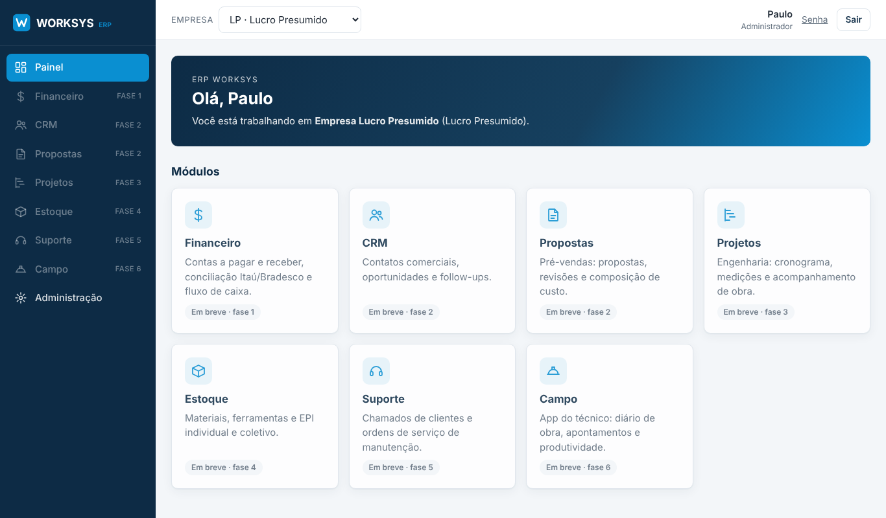

# ERP Worksys

ERP web da Worksys (engenharia elétrica e telecomunicações), instalado nos servidores
da empresa. Atende duas empresas (Simples Nacional e Lucro Presumido) com financeiro,
conciliação bancária Itaú/Bradesco, CRM, propostas, projetos, estoque/EPI, suporte e
app de campo.

- [Arquitetura](docs/ARQUITETURA.md)
- [Roadmap por fases](docs/ROADMAP.md)
- [Implantação no servidor](docs/IMPLANTACAO.md)



## Desenvolvimento

Requisitos: Python 3.12+ (PostgreSQL opcional; sem ele usa SQLite).

```sh
python3 -m venv .venv && . .venv/bin/activate
pip install -r requirements.txt
export DJANGO_DEBUG=1
python manage.py migrate
python manage.py createsuperuser
python manage.py runserver
```

Para usar PostgreSQL local, defina `POSTGRES_DB`, `POSTGRES_USER`, `POSTGRES_PASSWORD`
e `POSTGRES_HOST`.

Testes: `python manage.py test`

## Estrutura

```
config/          configurações Django
apps/core/       empresas, empresa ativa, layout e painel
apps/accounts/   usuários, perfis e login
templates/       páginas
static/          CSS e imagens (cores em variáveis no topo de static/css/worksys.css)
deploy/          nginx e backup
docs/            documentação
```
